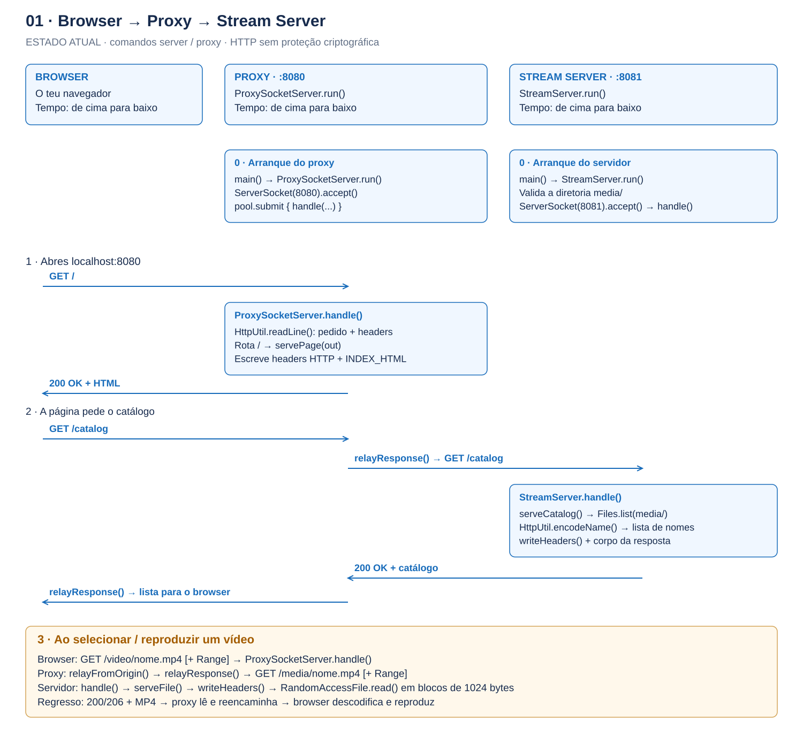
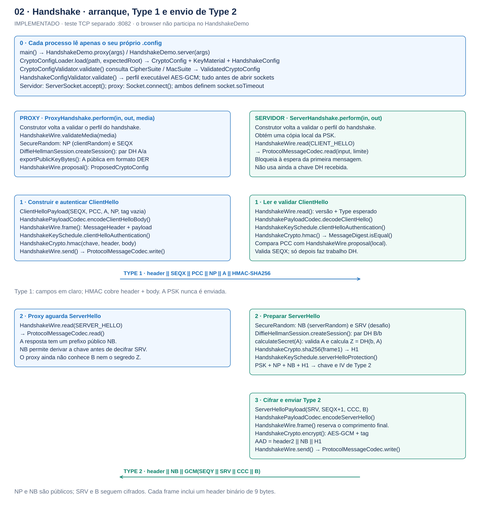
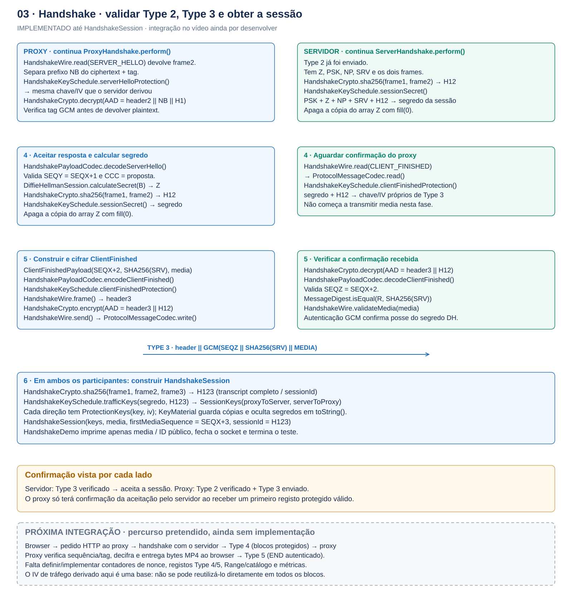
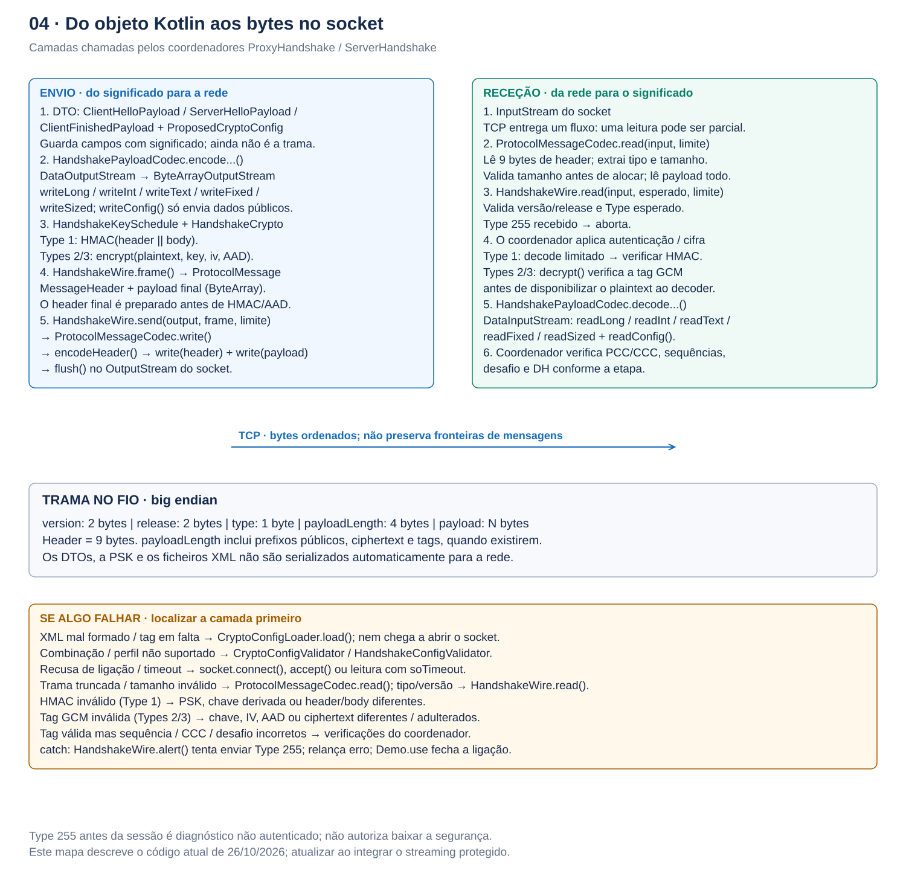

# Mapa da comunicação — guia de estudo

**Nota de atualização:** este guia e as figuras retratam a etapa anterior aos Types 4/5.
A transferência protegida e a divisão atual dos coordenadores por mensagem estão descritas em
[secure-stream.md](secure-stream.md). A integração HTTP/browser está agora implementada; consulta também [secure-browser.md](secure-browser.md).

Estado retratado do código em **26/10/2026**, antes desse incremento. Lê as figuras pela ordem indicada e, em cada uma, de cima para baixo. Os nomes correspondem às classes, objetos e funções existentes no projeto. As figuras descrevem o código implementado; as áreas tracejadas indicam trabalho futuro.

**Há atualmente dois percursos independentes:** `server` / `proxy` reproduzem vídeo HTTP sem proteção; `handshake-server` / `handshake-proxy` exercitam apenas o estabelecimento autenticado de chaves. O browser ainda não desencadeia o handshake. Cada processo lê apenas o seu próprio `.config`.

[PDF com as quatro figuras](diagrams/sequencia-comunicacao.pdf) — texto e formas vetoriais, para ampliar ou imprimir.

## 1. Browser, proxy e servidor: reprodução atual

[PNG](diagrams/01-browser-proxy-server.png) · [SVG vetorial](diagrams/01-browser-proxy-server.svg) · [Excalidraw editável](diagrams/01-browser-proxy-server.excalidraw)

O browser é o navegador do teu computador. Recebe o HTML do proxy e executa o JavaScript dessa página. Há vários pedidos HTTP: primeiro a página, depois o catálogo e, ao selecionar o vídeo, pedidos de conteúdo. A obtenção de metadados também pode provocar um pedido de vídeo antes de carregares em Play. Ao procurar outra posição, o browser pode abrir novas ligações com `Range`.

No proxy, `ProxySocketServer.handle()` lê o pedido com `HttpUtil.readLine()` e escolhe a rota:

| Pedido | Chamadas no proxy | Chamadas no servidor |
| --- | --- | --- |
| `GET /` | `servePage()` escreve headers HTTP e `INDEX_HTML` | Não contacta o servidor |
| `GET /catalog` | `relayResponse()` abre um socket e pede `/catalog` | `StreamServer.handle()` → `serveCatalog()` → `Files.list()` → `HttpUtil.encodeName()` → `writeHeaders()` |
| `GET /video/nome.mp4` | `relayFromOrigin()` → `relayResponse()`; transforma o caminho em `/media/nome.mp4` e preserva `Range` | `handle()` → `HttpUtil.decodeName()` → valida caminho/ficheiro → `serveFile()` → `writeHeaders()` → `RandomAccessFile` |
| Pedido inválido / rota desconhecida | `writeSimpleStatus()` devolve, conforme o caso, 400/404; falhas do catálogo podem gerar 502 | `writeStatus()` / `writeHeaders()` devolvem erros HTTP conforme o caso |

`serveFile()` lê até 1024 bytes de cada vez; `relayResponse()` também usa um buffer de 1024 bytes. As leituras TCP não têm de coincidir com as escritas do servidor. O proxy reencaminha bytes progressivamente, sem carregar o vídeo inteiro em memória. O atraso artificial é, por omissão, 2000 ms por leitura no proxy; o argumento `0` permite observar a reprodução sem esse atraso.

## 2. Handshake: configuração, Type 1 e envio de Type 2

[PNG](diagrams/02-handshake-type1-type2.png) · [SVG vetorial](diagrams/02-handshake-type1-type2.svg) · [Excalidraw editável](diagrams/02-handshake-type1-type2.excalidraw)

A configuração passa por três níveis: `CryptoConfigLoader.load()` verifica e interpreta a estrutura XML; `CryptoConfigValidator.validate()` aplica as regras das primitivas descritas em `CipherSuite` / `MacSuite`; `HandshakeConfigValidator.validate()` exige um perfil que o handshake já saiba executar. O catálogo de regras inclui outras suites, mas o handshake implementado aceita apenas AES-GCM.

`HandshakeDemo` é responsável pelo socket e pelos timeouts. Os coordenadores `ProxyHandshake` e `ServerHandshake` recebem os streams e executam a sequência. Não carregam novamente o XML; os construtores repetem apenas a validação do perfil.

Para ler a notação:

| Símbolo | Significado no código |
| --- | --- |
| PSK | Segredo previamente partilhado, carregado localmente; nunca transmitido |
| `a`, `A` | Chave privada DH do proxy e respetiva pública; geradas por sessão |
| `b`, `B` | Chave privada DH do servidor e respetiva pública; geradas por sessão |
| NP | `clientRandom`: 32 bytes aleatórios do proxy, em claro em Type 1 |
| NB | `serverRandom`: 32 bytes aleatórios públicos, prefixo de Type 2 |
| SRV | Desafio de 32 bytes do servidor, dentro da parte cifrada de Type 2 |
| PCC / CCC | Proposta / confirmação da configuração pública, representadas por `ProposedCryptoConfig` |
| `H1` | SHA-256 do frame Type 1 completo, incluindo header e tag |
| `GCM(...)` | Ciphertext seguido da tag de autenticação, produzidos por `HandshakeCrypto.encrypt()` |
| `||` | Concatenação de bytes, na ordem indicada |

A chave HMAC de Type 1 é **derivada** da PSK e NP. A chave/IV de Type 2 são derivados da PSK, NP, NB e H1. Assim o proxy consegue decifrar Type 2 antes de conhecer a pública DH do servidor. NB e SRV têm funções distintas: NB permite essa derivação antecipada; SRV é o desafio cifrado ao qual o proxy responde em Type 3.

`DiffieHellmanSession.createSession()` consulta `DhGroup.parameters()` para usar o grupo configurado. `calculateSecret()` reconstrói a pública remota a partir dos bytes DER, valida grupo/valor/subgrupo e usa `KeyAgreement.init()` → `doPhase()` → `generateSecret()`. O resultado Z ainda não é uma chave AES.

## 3. Handshake: Type 3 e sessão resultante

[PNG](diagrams/03-handshake-type3-session.png) · [SVG vetorial](diagrams/03-handshake-type3-session.svg) · [Excalidraw editável](diagrams/03-handshake-type3-session.excalidraw)

Os dois lados obtêm o mesmo segredo DH: `DH(a, B) = DH(b, A) = Z`. `HandshakeKeySchedule.sessionSecret()` combina PSK, Z, NP, SRV e o hash dos dois primeiros frames. Internamente utiliza `HandshakeCrypto.extract()` e `expand()` — HKDF-SHA256 — com etiquetas diferentes para separar as funções de cada chave.

`SHA256(SRV)` isoladamente não autentica o proxy. A prova relevante é conseguir produzir um Type 3 válido sob a chave derivada do segredo da sessão, incluindo o contexto do handshake em AAD. Depois de decifrar, o servidor também verifica a sequência, a resposta ao desafio e a sintaxe do nome de media.

| Objeto devolvido | Responsabilidade |
| --- | --- |
| `ProtectionKeys` | Agrupa uma chave e um IV/base de IV |
| `SessionKeys` | Agrupa `proxyToServer` e `serverToProxy`, com material distinto por direção |
| `KeyMaterial` | Guarda cópias defensivas dos bytes e oculta o valor em `toString()` |
| `HandshakeSession` | Transporta chaves, nome de media, primeira sequência de dados e ID público da sessão |

O hash completo dos três frames, H123, é usado na derivação das chaves de tráfego e como `sessionId`. É um identificador público; não é o segredo de sessão. Os bytes de segredo/PSK copiados são limpos com `fill(0)` no percurso de sucesso; isso não garante a eliminação de todas as cópias de memória na JVM.

**Confirmação assimétrica neste ponto:** o servidor só devolve `HandshakeSession` depois de verificar Type 3. O proxy devolve a sua sessão depois de enviar Type 3; ainda não sabe se o servidor o aceitou. O primeiro registo protegido válido do servidor dará essa confirmação na futura integração. Não existe uma quarta mensagem de handshake implementada.

O demo termina aqui, sem abrir nem transmitir o ficheiro pedido. A validação de `media` no handshake é sintática; não verifica se o ficheiro existe.

## 4. Camadas, bytes e localização de falhas

[PNG](diagrams/04-codecs-wire-errors.png) · [SVG vetorial](diagrams/04-codecs-wire-errors.svg) · [Excalidraw editável](diagrams/04-codecs-wire-errors.excalidraw)

`MessagePayload` é a interface dos payloads tipados; `MessageType` associa nomes aos códigos 1, 2, 3, 4, 5 e 255. A existência dos códigos 4 e 5 no enum não significa que a transmissão protegida já esteja implementada.

`HandshakePayloadCodec` conhece os campos dentro de cada payload. `ProtocolMessageCodec` conhece o envelope comum: `MessageHeader` + bytes do payload. `HandshakeWire` combina esse envelope com regras do handshake, como a versão e o tipo esperado. São chamados pelos coordenadores; não existe um mecanismo automático que percorra as classes.

Em Type 1, o coordenador usa `encodeClientHelloBody()` e acrescenta a tag depois de a calcular. O helper `encodeClientHello()` também existe, mas não é a chamada usada por esse percurso atual. Na receção, o servidor faz parsing limitado de Type 1 antes de verificar HMAC para obter NP e os campos necessários; só confia neles após a verificação e antes do trabalho DH. Nos Types 2/3, verifica a tag GCM antes de descodificar o plaintext.

O header final é necessário para calcular HMAC/AAD. Por isso o coordenador pode criar primeiro um `ProtocolMessage` com um array do tamanho final e substituir depois o payload pelo conteúdo autenticado/cifrado. Isso não envia zeros: `HandshakeWire.send()` só é chamado quando o frame final está pronto.

**Para investigar uma falha, segue esta ordem:** configuração local → socket → header/tamanho/tipo → autenticação/decifragem → conteúdo/estado. Uma falha de tag não permite concluir, por si só, que houve ataque: pode resultar de uma diferença no código de derivação, no IV, na PSK, no transcript ou nos bytes autenticados.

`HandshakeWire.alert()` tenta emitir Type 255 e a exceção sobe até ao chamador, que fecha o socket através de `use`. Um alerta anterior à sessão não é autenticado e não justifica aceitar algoritmos mais fracos.

## O que ainda falta ligar

O percurso pretendido é: pedido HTTP do browser → proxy estabelece sessão segura com o servidor → servidor envia Type 4 → proxy valida sequência/tag, decifra e entrega MP4 ao browser → Type 5 autentica o fim da transmissão. Ainda falta implementar os registos protegidos, contadores/nonces, integração de media/Range/catálogo e métricas. Os nomes dessas futuras classes não foram inventados nos diagramas.

A proteção desenvolvida neste trabalho incide na ligação proxy ↔ servidor. O proxy continua a ter acesso ao conteúdo em claro para o entregar ao browser.

## Utilizar as figuras

- **README:** SVG, que mantém o texto nítido ao ampliar; PNG como alternativa.
- **Relatório:** SVG ou PDF vetorial de cada figura; escolher as figuras/recortes adequados ao limite de páginas. O conjunto detalhado destina-se também ao estudo e não precisa de ocupar todo o relatório.
- **Caderno:** seguir as figuras 1 → 2 → 3 → 4 e copiar uma etapa de cada vez.
- **Editar:** abrir o ficheiro `.excalidraw` em Excalidraw através de Open ou arrastar o ficheiro para o editor. As quatro figuras contêm, respetivamente, 54, 70, 68 e 59 elementos editáveis; cada uma representa uma parte do percurso.

Para os formatos exatos e as decisões do protocolo, consultar também [handshake.md](handshake.md). Este mapa deve acompanhar as próximas alterações do código.
